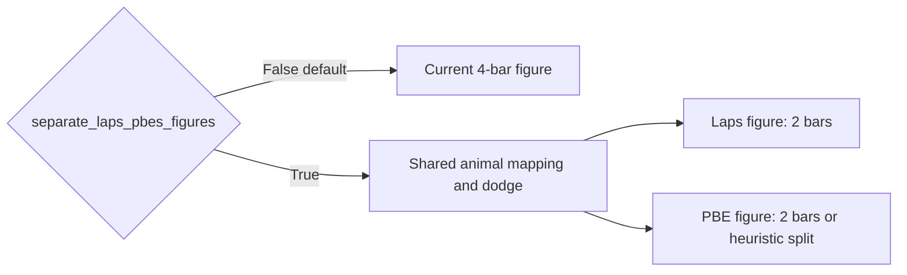

# Split summary bars into Laps and PBE figures (opt-in)

Gate on a new kwarg:

```python
separate_laps_pbes_figures: bool = False
```

- **`False` (default):** current single 4-bar figure. Callers and `out['fig']` stay unchanged.
- **`True`:** two figures (same pattern as `PaperFigureTwo.display`: Laps figure + PBE figure).

## Layout when split

- **Laps figure:** two full-width bars (pre-Δ, post-Δ), animal dodge + pair-lines, Laps p-value bracket on 0–1.
- **PBE figure:** same two bars by default. If heuristic-passing data is present, split each column into adjacent half-width bars at `x=0` and `x=1` (all-PBEs | heuristic-passing), with the extra green bracket on the heuristic pair.

Split titles become `for Laps` / `for PBEs`. Animal marker mapping is still computed once from both summaries so both legends match.



## Code changes

All in [`PhoDiba2023Paper.py`](h:\TEMP\Spike3DEnv_ExploreUpgrade\Spike3DWorkEnv\pyPhoPlaceCellAnalysis\src\pyphoplacecellanalysis\SpecificResults\PhoDiba2023Paper.py).

**1. Teach grouped x-ticks to handle one pair (used only by the split path)**

[`PaperFigureTwo._apply_publication_grouped_xticklabels`](h:\TEMP\Spike3DEnv_ExploreUpgrade\Spike3DWorkEnv\pyPhoPlaceCellAnalysis\src\pyphoplacecellanalysis\SpecificResults\PhoDiba2023Paper.py) currently hardcodes 4 ticks and two group labels. That would break a 2-bar figure.

Keep the existing 2-group / 4-bar path unchanged (Figure 2 and the default summary). If `len(group_labels)==1`, set ticks at `[0, 1]` with `pre-Δ` / `post-Δ` and one secondary label at `0.5`.

**2. Default path vs split helper**

Add `separate_laps_pbes_figures: bool = False` next to `enable_paired_lines`.

- **`False`:** leave the existing 4-bar plotting/saving/return body as-is (including current heuristic 6-bar layout at `[0, 1, 2±off, 3±off]`).
- **`True`:** nested `_plot_one_panel(...)` that:
  - Calls `PaperFigureTwo.create_plot` with 2 `y_values` (or 4 half-width bars for heuristic PBE)
  - Draws pair-lines, significance bars, animal legend (and heuristic legend only on PBE)
  - Saves with a distinct `fignum` / `fig_file_name` suffix (`...-Laps`, `...-PBEs`) so windows and exports do not overwrite each other

Shared coerce / unwrap / animal-mapping stays above the branch. Heuristic PBE `bar_x` on the split path becomes `[0-off, 0+off, 1-off, 1+off]`.

**3. Return dict**

- **Default:** unchanged (`fig`, `ax`, `render`, `saved_paths`, …).
- **Split:** nested `laps` / `pbe` each `{fig, ax, render, saved_paths, ...}`; `figs = [laps_fig, pbe_fig]`; `saved_paths` concatenated; `fig` / `ax` still the Laps panel so `out['fig']` does not KeyError.

**4. Callers**

[`FigureS8.main_all_figs`](h:\TEMP\Spike3DEnv_ExploreUpgrade\Spike3DWorkEnv\pyPhoPlaceCellAnalysis\src\pyphoplacecellanalysis\SpecificResults\PhoDiba2023Paper.py) already passes `fig_file_name=active_fignum` and does not need the flag unless we later opt it in. Do not edit notebooks.

## Out of scope

Error bars, `**` size/placement, title chrome, and shared `ylim=(0, 1.05)` stay as they are. Split-path y-limits are independent per figure (each panel’s own `nanmax`).
