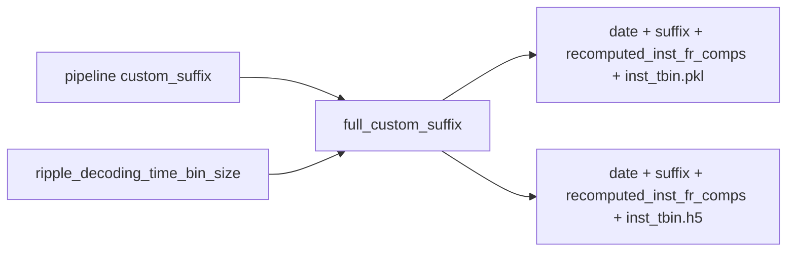

# Suffixed `recomputed_inst_fr_comps` filenames (+ finish mat test)

## Context

Shuffle `.mat` naming helper/call sites are already landed from the prior plan (`build_standalone_mat_filename` + 3 batch sites). Remaining from that work: run/verify the mat filename unit test.

Standalone inst-FR exports still use bare names in [`compute_and_export_session_instantaneous_spike_rates_completion_function`](h:/TEMP/Spike3DEnv_ExploreUpgrade/Spike3DWorkEnv/pyPhoPlaceCellAnalysis/src/pyphoplacecellanalysis/General/Batch/BatchJobCompletion/UserCompletionHelpers/batch_user_completion_helpers.py):

```2201:2201:h:/TEMP/Spike3DEnv_ExploreUpgrade/Spike3DWorkEnv/pyPhoPlaceCellAnalysis/src/pyphoplacecellanalysis/General/Batch/BatchJobCompletion/UserCompletionHelpers/batch_user_completion_helpers.py
            standalone_filename: str = f'{get_now_day_str()}_recomputed_inst_fr_comps_{_out_recomputed_inst_fr_comps.instantaneous_time_bin_size_seconds}.pkl'
```

```2226:2226:h:/TEMP/Spike3DEnv_ExploreUpgrade/Spike3DWorkEnv/pyPhoPlaceCellAnalysis/src/pyphoplacecellanalysis/General/Batch/BatchJobCompletion/UserCompletionHelpers/batch_user_completion_helpers.py
            standalone_h5_filename: str = f'{get_now_day_str()}_recomputed_inst_fr_comps_{_out_recomputed_inst_fr_comps.instantaneous_time_bin_size_seconds}.h5'
```

That produces `output/2026-11-02_recomputed_inst_fr_comps_1000.0.{pkl,h5}` with no qclu/replay/frate/decoding-tbin identity.

## Target filename

Flat under session `output/`, same suffix vocabulary as shuffle outputs:

`{YYYY-MM-DD}{full_custom_suffix}_recomputed_inst_fr_comps_{instantaneous_time_bin_size}.{pkl|h5}`

Example:

`2026-11-02_withNormalComputedReplays-qclu_[1, 2, 4, 6, 7, 9]-frateThresh_5.0-tbin_25ms_recomputed_inst_fr_comps_1000.0.pkl`

- `full_custom_suffix` = pipeline `custom_suffix` (replay/qclu/frate) + `-tbin_XXms` via the same rules as `DecodedEpochScoreShuffle.build_full_custom_suffix`
- Trailing `_{instantaneous_time_bin_size}` stays (this is the inst-FR bin, e.g. `1000.0`, not decoding tbin)



## Implementation

### 1. Finish shuffle `.mat` test (already coded)

- Keep existing `build_standalone_mat_filename` + batch call-site edits.
- Run `tests/test_epoch_score_shuffle.py -k mat_filename` once the env can import (or validate via a minimal unittest isolated from Qt if needed). Mark `mat-filename-tests` done.

### 2. Filename helper for inst-FR

In [`LongShortTrackComputations.py`](h:/TEMP/Spike3DEnv_ExploreUpgrade/Spike3DWorkEnv/pyPhoPlaceCellAnalysis/src/pyphoplacecellanalysis/General/Pipeline/Stages/ComputationFunctions/MultiContextComputationFunctions/LongShortTrackComputations.py) on `InstantaneousSpikeRateGroupsComputation` (or a tiny module-level helper next to it):

- `build_recomputed_inst_fr_comps_filename(full_custom_suffix, instantaneous_time_bin_size_seconds, extension: str, date_str=None) -> str`
  - Normalize suffix (leading `_`), refuse empty suffix
  - Default `date_str=get_now_day_str()` (preserve day-only date style used today, not rounded minute)
  - Return `f'{date_str}{suffix}_recomputed_inst_fr_comps_{instantaneous_time_bin_size_seconds}{extension}'` with `extension` including the dot

Reuse `DecodedEpochScoreShuffle.build_full_custom_suffix(curr_active_pipeline=...)` at the call site to build the suffix (same pipeline + ripple tbin resolution already proven for shuffles). Avoid duplicating tbin logic.

### 3. Write sites — [`batch_user_completion_helpers.py`](h:/TEMP/Spike3DEnv_ExploreUpgrade/Spike3DWorkEnv/pyPhoPlaceCellAnalysis/src/pyphoplacecellanalysis/General/Batch/BatchJobCompletion/UserCompletionHelpers/batch_user_completion_helpers.py)

In `_subfn_single_time_bin_size_compute_and_export_session_instantaneous_spike_rates_completion_function`:

- After successful compute, once: `full_custom_suffix = DecodedEpochScoreShuffle().build_full_custom_suffix(curr_active_pipeline=curr_active_pipeline)` (or equivalent with a lightweight instance / shared helper).
- Replace both hardcoded `.pkl` and `.h5` filename strings with `InstantaneousSpikeRateGroupsComputation.build_recomputed_inst_fr_comps_filename(...)`.
- Update the function docstring Output Files section to the new pattern.
- Leave FAT CSV and across-session shared HDF paths unchanged (FAT already uses `build_complete_session_identifier_filename_string`; across-session HDF is a shared collected file).

### 4. Discovery — [`AcrossSessionResults.py`](h:/TEMP/Spike3DEnv_ExploreUpgrade/Spike3DWorkEnv/pyPhoPlaceCellAnalysis/src/pyphoplacecellanalysis/SpecificResults/AcrossSessionResults.py)

`copy_session_inst_fr_data_to_across_session_pkl` currently hardcodes:

`f'{RESULT_DATE_TO_USE}_recomputed_inst_fr_comps_{time_bin_size}.pkl'`

Change:

- Add `full_custom_suffix: Optional[str] = None` to `copy_session_inst_fr_data_to_across_session_pkl`.
- Build expected name with the same helper when `full_custom_suffix` is provided.
- When resolving a session file: try exact suffixed path first; if missing, fall back to legacy unsuffixed `{date}_recomputed_inst_fr_comps_{tbin}.pkl` so old outputs still load.
- Example docstring / usage comment at L1599 updated to the suffixed pattern.

### 5. Tests

- Extend [`tests/test_epoch_score_shuffle.py`](h:/TEMP/Spike3DEnv_ExploreUpgrade/Spike3DWorkEnv/pyPhoPlaceCellAnalysis/tests/test_epoch_score_shuffle.py) mat test already added (or leave as-is).
- Add a small unit test for `build_recomputed_inst_fr_comps_filename` (suffix + `-tbin_25ms` + trailing `1000.0` + `.pkl`/`.h5`); empty suffix raises.

## Out of scope

- Renaming existing on-disk unsuffixed inst-FR files
- Changing across-session aggregate pickle names (`across_session_result_long_short_recomputed_inst_firing_rate_...`)
- Notebook edits unless a notebook is explicitly attached later
