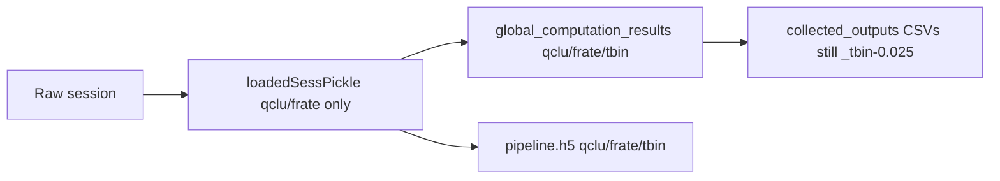

# Tbin-suffixed global pickle and pipeline HDF5

## Naming convention

- `time_bin_size: float = 0.025` (seconds) → token `"25ms"` (integer milliseconds, no decimals).
- Filename fragment: `-tbin_25ms` (same pattern as existing `job_suffix` / `archive_qclus_75ms_pickles.py`).
- If laps and ripple bins differ: `-tbin_laps25ms_ripple75ms`. If they match, a single `-tbin_25ms`.
- **Do not** put tbin on `loadedSessPickle{qclu/frate}.pkl` (reusable across decoding bins).
- **Do not** change collected_outputs CSV/posterior tokens (`_tbin-0.025` stays). Parsers will accept both forms.

Example after change:

- Load/save local: `loadedSessPickle_withNormalComputedReplays-qclu_[1, 2, 4, 6, 7, 8, 9]-frateThresh_2.0.pkl`
- Load/save global: `output/global_computation_results_withNormalComputedReplays-qclu_[1, 2, 4, 6, 7, 8, 9]-frateThresh_2.0-tbin_25ms.pkl`
- Session pipeline h5: `output/pipeline_withNormalComputedReplays-qclu_[1, 2, 4, 6, 7, 8, 9]-frateThresh_2.0-tbin_25ms.h5`

## 1. Shared format/parse helpers

Add in [NeuropyPipeline.py](h:/TEMP/Spike3DEnv_ExploreUpgrade/Spike3DWorkEnv/pyPhoPlaceCellAnalysis/src/pyphoplacecellanalysis/General/Pipeline/NeuropyPipeline.py) next to `_get_custom_suffix_for_filename_from_computation_metadata`:

- `format_decoding_time_bin_size_filename_token(time_bin_size: float) -> str` → `"25ms"`
- `build_decoding_time_bin_size_filename_suffix(laps=..., ripple=...) -> str` → `"-tbin_25ms"` or `"-tbin_laps25ms_ripple75ms"`
- `parse_decoding_time_bin_size_str(s) -> Optional[float]` accepts `"0.025"`, `"25ms"`, `"tbin-0.025"`, `"tbin_25ms"`

Use nearest-integer milliseconds (`round(seconds * 1000)`).

## 2. Filename builders (session outputs only)

Update [`_get_custom_filenames_from_computation_metadata`](h:/TEMP/Spike3DEnv_ExploreUpgrade/Spike3DWorkEnv/pyPhoPlaceCellAnalysis/src/pyphoplacecellanalysis/General/Pipeline/NeuropyPipeline.py) to take optional `laps_decoding_time_bin_size` / `ripple_decoding_time_bin_size` and append the tbin fragment **only** to:

- `global_computation_pkl`
- `pipeline_h5`

Leave `pipeline_pkl` on qclu/frate/replay only.

Update [`get_custom_pipeline_filenames_from_parameters`](h:/TEMP/Spike3DEnv_ExploreUpgrade/Spike3DWorkEnv/pyPhoPlaceCellAnalysis/src/pyphoplacecellanalysis/General/Pipeline/Stages/Computation.py) to read bin sizes from `computation_config.merged_directional_placefields` and pass them in. Keep `custom_suffix` itself **without** tbin so CSV identity strings from `get_complete_session_identifier_string()` do not double-encode tbin.

Fix [`global_computation_results_pickle_path`](h:/TEMP/Spike3DEnv_ExploreUpgrade/Spike3DWorkEnv/pyPhoPlaceCellAnalysis/src/pyphoplacecellanalysis/General/Pipeline/Stages/Computation.py): today it copies the local pickle suffix (`special_pickle_designator_suffix`). After this change that would omit tbin. Append the tbin fragment from computation_config when present so un-overridden `save_global_computation_results()` writes the tbin-suffixed path.

## 3. Batch scripts: load and save global pickle with tbin

[`python_template.py.j2`](h:/TEMP/Spike3DEnv_ExploreUpgrade/Spike3DWorkEnv/pyPhoPlaceCellAnalysis/src/pyphoplacecellanalysis/Resources/Templates/python_template.py.j2) currently:

- local load/save: `loadedSessPickle{parameter_specifier_str}.pkl` (keep)
- global **load**: `global_computation_results{parameter_specifier_str}.pkl` (no tbin — **wrong after this change**)
- global **save**: `global_computation_results{parameter_output_specifier_str}.pkl`

Change global **load and save** to the tbin-suffixed name. Pass a dedicated Jinja value (e.g. `decoding_time_bin_filename_suffix`) from `active_phase_dict` rather than overloading `override_custom_pickle_output_suffix` (already used for track-body variants).

In [ProcessBatchOutputs_qclus1246789_Only.ipy](h:/TEMP/Spike3DEnv_ExploreUpgrade/Spike3DWorkEnv/Spike3D/ProcessBatchOutputs_qclus1246789_Only.ipy) (and the other kdiba `ProcessBatchOutputs*.ipy` that set `override_custom_pickle_suffix`):

- After `laps_decoding_time_bin_size` / `ripple_decoding_time_bin_size` are set, compute the token and put it on `active_phase_dict` so generated scripts pick it up.
- Keep `override_custom_pickle_suffix` as qclu/frate only (local pickle reuse).

Missing 75ms global pickle on a continued/final run is the desired behavior: rebuild globals from the shared local pickle, then save `-tbin_75ms`.

## 4. Parsers (accept `25ms` and `0.025`)

Do **not** rewrite CSV names. Make post-hoc parsing tolerant:

- [`try_convert_to_float`](h:/TEMP/Spike3DEnv_ExploreUpgrade/Spike3DWorkEnv/pyPhoPlaceCellAnalysis/src/pyphoplacecellanalysis/SpecificResults/AcrossSessionResults.py) (or a dedicated helper used there) must parse `"25ms"` → `0.025` instead of NaN.
- [`DayDateTimeParser`](h:/TEMP/Spike3DEnv_ExploreUpgrade/Spike3DWorkEnv/pyPhoCoreHelpers/src/pyphocorehelpers/Filesystem/path_helpers.py) `_tbin-` regex: also match `_tbin_25ms` / `-tbin_25ms`.
- Add cases to the `parse_filename` expected-results dict in AcrossSessionResults for `25ms` tokens (pickle/h5-style and mixed).

`custom_replay_name` for CSVs stays `withNormalComputedReplays-qclu_...-frateThresh_2.0` (no tbin). Session pickle globbers / archive script will look for `-tbin_25ms` on global pkl/h5 only.

## 5. Rename script for current 25ms session files

Add [Spike3D/scripts/rename_session_outputs_add_tbin_25ms.ipy](h:/TEMP/Spike3DEnv_ExploreUpgrade/Spike3DWorkEnv/Spike3D/scripts/rename_session_outputs_add_tbin_25ms.ipy) (same session list / qclu specifiers as `archive_qclus_75ms_pickles.py`):

- Targets that **lack** `-tbin_`:
  - `output/global_computation_results{qclu_suffix}.pkl` → `...-tbin_25ms.pkl`
  - `output/pipeline{qclu_suffix}.h5` → `...-tbin_25ms.h5`
- **Do not** rename `loadedSessPickle{qclu_suffix}.pkl`.
- Skip if dest exists or name already has `-tbin_`.
- Dry-run by default; `--execute` to move.
- Do not touch unsuffixed `loadedSessPickle.pkl` / `global_computation_results.pkl` (warn if present).

Update [archive_qclus_75ms_pickles.py](h:/TEMP/Spike3DEnv_ExploreUpgrade/Spike3DWorkEnv/Spike3D/scripts/archive_qclus_75ms_pickles.py) comments/paths so it does not fight the new canonical `-tbin_25ms` names (archive of a 75ms run should look for `-tbin_75ms`, not rewrite the unsuffixed-by-tbin files).

## 6. Out of scope (intentionally)

- collected_outputs CSV/posterior `_tbin-0.025` format
- Forcing tbin onto local pipeline pickles
- Computation validators comparing stored vs requested tbin (useful later; not required for this naming change)
- Banning unsuffixed pickles in interactive loaders (separate follow-up)

## Verification

- Unit-level: `0.025→25ms`, `0.075→75ms`, `0.250→250ms`; parse both `"0.025"` and `"25ms"` to `0.025`.
- `get_custom_pipeline_filenames_from_parameters` returns local pickle without tbin, global pkl + h5 with `-tbin_25ms`.
- Generated batch script paths: local override without tbin, global override with tbin.
- `parse_filename` existing expected fixtures still pass; new `25ms` fixtures pass.
- Rename script dry-run lists only global pkl/h5, never local pickle.
