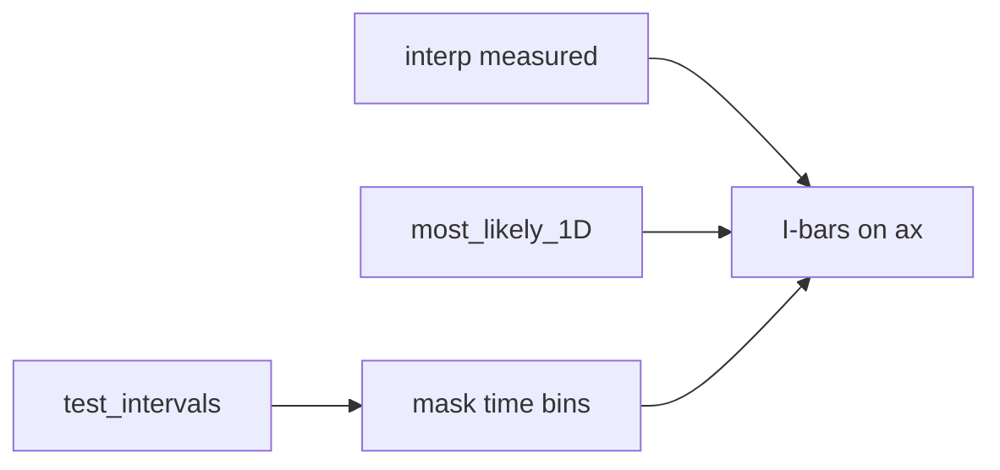

# Test-interval measured↔decoded I-bars

## Goal
On the 5-col laps figure, inside each orange **test** bracket, draw small vertical **I-bars** from measured position (red traj) to decoded most-likely position at each time bin — displacement that feeds the left GT test-err cell.

## Defaults (locked)
- **Where:** all four decoder columns (GT shows small bars; wrong decoders show large ones).
- **When:** only bins whose centers fall inside that row’s `test_intervals` (not train).
- **Decoded:** `marginal_x_list[lap_idx].most_likely_positions_1D` (do **not** enable the continuous gray most-likely line; keep `skip_plotting_most_likely_positions=True`).
- **Measured:** interpolate `global_pos_df` onto the lap’s time-bin centers via existing `TrainTestLapsSplitting.interpolate_positions` (prefer `lin_pos` / `variable_name`, else `x`).
- **Style:** thin white/cyan I-bars (`color='#00ffff'`, `alpha≈0.85`, `lw≈0.7`, small caps), `zorder` above measured line (~14).
- **Skip:** non-finite measured or decoded bins; no-op if `test_intervals` empty.

## Implementation
All in [`DirectionalPlacefieldGlobalComputationFunctions.py`](h:/TEMP/Spike3DEnv_ExploreUpgrade/Spike3DWorkEnv/pyPhoPlaceCellAnalysis/src/pyphoplacecellanalysis/General/Pipeline/Stages/ComputationFunctions/MultiContextComputationFunctions/DirectionalPlacefieldGlobalComputationFunctions.py) inside `_display_laps_correct_decoder_side_by_side_posteriors`:

1. Add nested `_subfn_draw_test_interval_measured_decoded_ibars(ax, time_bin_centers, measured_y, decoded_y, test_intervals, ...)`:
   - Build boolean mask: center in any `[t0,t1]` of `test_intervals`.
   - Finite mask on measured/decoded.
   - `ax.vlines` (or `errorbar` with midpoint + half |Δ|) + short horizontal caps at both ends.

2. In `_subfn_plot_laps_four_decoder_posterior_page` decoder loop (after measured-line styling / before or after train-test brackets):
   - Always read `decoded_y = a_result.marginal_x_list[int(lap_idx)].most_likely_positions_1D`.
   - `interp_df = TrainTestLapsSplitting.interpolate_positions(global_pos_df, curr_time_bins, additional_interp_column_names=[variable_name] if present)`.
   - `measured_y` from `variable_name` (fallback `x`).
   - If `enable_train_test_spans` and `test_intervals`: call the I-bar helper.

3. Docstring one-liner on the page plotter noting test-interval I-bars.

No batch-helper / recipe changes — pure display overlay.

