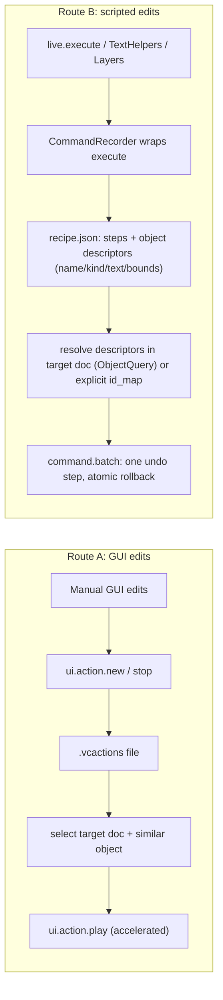

# VectorCraft Change Recording and Replay

## Goal
Record a series of changes made to an object, then apply them to a similar object via script — for edits made in the GUI (Route A) and edits made through Python (Route B), replayable in the same document or a different one.

## Verified primitives (live catalog, 1431 commands)
- Native Actions: `ui.action.new {set, name}` / `ui.action.record` → `ui.action.stop` → `ui.action.play {action, set?}` (accelerated = one undoable batch), `ui.actionSet.save {set, path}` → `.vcactions`, `ui.actionSet.load {path}`, `action.batch {commands, folder, ...}`.
- `command.batch {label?, commands: [{command, params}]}` — many commands as ONE undo step, rolls back everything on first error. Ideal replay executor.
- Document `history` is only undo labels (not replayable) — recording must happen at edit time.

## New module: `EXTERNAL/VectorCraft_Scripting/src/vectorcraft_scripting/record.py`
Follows package conventions (`TextHelpers`/`Layers` style: class with `@classmethod` + module-level alias functions; single-line signatures; two blank lines between methods; `## END for` loop comments).

### Route A — `Actions` class (native recorder wrapper)
- `start(live, name=None, set_index=0)` → `ui.action.new` (named) or `ui.action.record`; returns handle `{set, action, name}`.
- `stop(live)` → `ui.action.stop`.
- `record_action(live, name)` context manager (stop in `finally`).
- `save(live, path, set_index=0)` → `ui.actionSet.save` with absolute path; assert file exists.
- `load(live, path)` → `ui.actionSet.load`.
- `play(live, action, target_document=None, select_ids=None, set_name=None)` → optional `live.select_document(...)` + `assert_active_document`, optional `select.set {ids}` (recorded steps are selection/id-relative, so the similar object must be selected first), force `ui.action.playbackOptions {speed: 'accelerated'}`, then `ui.action.play`.
- `batch(live, action, folder, ...)` → `action.batch` for folder-wide replay.

### Route B — `CommandRecorder` + recipe replay
- `CommandRecorder(live)` context manager: wraps `live.execute` at instance level (restored on exit), capturing every mutating command as `{'command', 'params'}`. Read-only commands (`document.find`, `document.node`, `text.getRange`, `file.info`, `file.list`, `*.list`, …) skipped via an explicit denylist. All existing helpers (`TextHelpers`, `replace_layers`, …) are captured automatically since they call `live.execute`.
- Object descriptors captured at record time: for each referenced id (`ids`, `id`, `target` params) fetch `document.node` summary → `{name, kind, bounds}` (+ `text` via `text.getRange` for Type). Stored in `recipe['objects']`; step params keep raw ids, remapped at replay.
- Selection-dependent commands (e.g. `paint.setFill`, `edit.paste` with no `ids` param): snapshot current selection (`inspect_document(depth=0)` → `selection`) and prepend a recorded `select.set` step with descriptors.
- Recipe JSON: `{'version': 1, 'source_document': title, 'recorded_at': iso, 'objects': {old_id: descriptor}, 'steps': [...]}`. `save_recipe(recipe, path)` / `load_recipe(path)`.
- `replay_recipe(live, recipe, target_document=None, id_map=None, backup=True, label=...)`:
  1. `select_document` + `assert_active_document` when `target_document` given (same-doc replay: `None` = active doc).
  2. Resolve old→new ids: explicit `id_map` wins; else descriptor resolution via `find_by_name(exact=True)` filtered by kind, Type fallback to `ObjectQuery(text=...)` + nearest bounds. Assert exactly one match per descriptor (loud failure, no silent fallbacks); ambiguous same-doc cases use `id_map`.
  3. Recursively substitute ids in step params; drop `edit.undoGroup.*` steps (batch provides the undo step).
  4. `live.backup_document(expect_title=...)` when `backup=True`, then `live.execute('command.batch', {'label': ..., 'commands': steps})` — atomic, one undo step.
- Caveat documented: geometry-derived deltas (e.g. the corrective `object.move` inside `set_text_font_size_centered`) replay as recorded — exact for same-size similar objects; semantic re-computation can be added later if needed.

## Small edits
- [`__init__.py`](h:\TEMP\Spike3DEnv_ExploreUpgrade\Spike3DWorkEnv\Spike3D\EXTERNAL\VectorCraft_Scripting\src\vectorcraft_scripting\__init__.py): export `Actions`, `CommandRecorder`, `record_action`, `play_action`, `save_recipe`, `load_recipe`, `replay_recipe` (+ `__all__`).
- [`README.md`](h:\TEMP\Spike3DEnv_ExploreUpgrade\Spike3DWorkEnv\Spike3D\EXTERNAL\VectorCraft_Scripting\README.md): new "Record and replay changes" section with both routes and the selection-first caveat for `.vcactions`.
- [`VectorCraft_Scripting.ipynb`](h:\TEMP\Spike3DEnv_ExploreUpgrade\Spike3DWorkEnv\Spike3D\EXTERNAL\VectorCraft_Scripting\notebooks\VectorCraft_Scripting.ipynb) (explicitly in context, so editable): append two demo sections — (A) record a GUI tweak on the test figure, save `.vcactions`, replay onto a second copy; (B) `CommandRecorder` around `TextHelpers.set_text_font_size_centered`, save recipe, replay onto similar labels / second document.

## Tests and verification
- New `tests/test_record.py` (offline, fake live object — mirrors `test_live_auto_reconnect.py` style): read-only filtering, descriptor capture, id remapping (incl. nested `ids`/`target`), recipe round-trip, selection-step insertion, ambiguity assertion.
- Run `uv sync --all-extras` then `uv run pytest` in `EXTERNAL/VectorCraft_Scripting` (no new dependencies; stdlib `json` only).
- Live smoke test against the running instance using ONLY `data/test_input_figure.svg` copies (never the paper figures): record → save → replay cross-document and same-document; verify via bounds/text read-back.